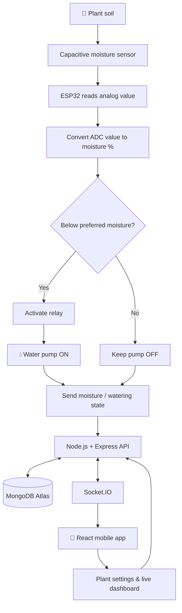

<div align="center">

# 🌿 HYDRO SPRAYER

### Smart watering. Happier plants. Less guesswork. 💧

**An IoT-powered automated plant watering and monitoring system**

[](https://www.espressif.com/)
[](https://react.dev/)
[](https://nodejs.org/)
[](https://www.mongodb.com/)
[](https://socket.io/)

*Growing smarter, one drop at a time. 🌱*

</div>

---

## 🌱 About the project

**Hydro Sprayer** is an IoT-based automated plant watering and monitoring system built around an **ESP32** microcontroller.

It reads soil moisture from capacitive moisture sensors and automatically switches water pumps through relay modules whenever a plant's moisture level falls below its preferred threshold.

A companion mobile application lets users manage their plants, choose moisture targets, monitor live readings, and receive watering notifications. The ESP32 communicates with a Node.js backend, while Socket.IO keeps the app updated as sensor readings and watering states change.

The current firmware and server configuration support **up to five plant sensor-and-pump slots** for the configured ESP32 unit.

> 💧 **The goal:** give every plant the water it needs, right when it needs it.

## ✨ What it can do

- 🌿 **Monitor soil moisture** — read capacitive moisture sensors and convert ADC readings into percentages.
- 💦 **Automatic watering** — turn the matching pump on when moisture is below the plant's preferred level, and turn it off when the target is reached.
- 🎚️ **Individual moisture targets** — set a preferred moisture percentage for each plant from the app.
- 📱 **Plant management** — add, view, edit, and delete plants.
- 📊 **Live dashboard** — view moisture gauges, preferred moisture, watering state, and last watering time.
- 🔔 **Watering notifications** — receive an in-app notification when watering starts.
- ⚡ **Real-time updates** — Socket.IO sends moisture and plant-state changes to the mobile app.
- 🔌 **Automatic pin-slot assignment** — the backend assigns an available sensor/relay slot when a plant is added.
- 🔄 **Configuration refresh** — the ESP32 reloads plant assignments periodically, so app changes can reach the hardware without reflashing.

## 🧠 How the system works



### The watering cycle

1. The ESP32 connects to Wi-Fi and requests the owner's plant configuration from the backend.
2. The backend returns the registered plants, preferred moisture levels, and assigned sensor-slot information.
3. Every **5 seconds**, the ESP32 reads the active moisture sensors.
4. The firmware converts each raw ADC value into a moisture percentage using its configured dry and wet calibration values.
5. If the reading is below the plant's preferred moisture level, the ESP32 energizes that plant's relay and starts its pump.
6. When the reading reaches or exceeds the preferred level, the ESP32 switches the relay off.
7. Moisture readings and watering events are sent to the backend. The backend stores the latest state and notifies the relevant mobile app through Socket.IO.
8. Every **60 seconds**, the ESP32 refreshes its plant configuration.

## 🧩 System architecture

Hydro Sprayer is made of three connected parts:

| Part | Directory | Responsibility |
| --- | --- | --- |
| ESP32 firmware | `hydro-sprayer_esp/` | Reads sensors, controls relays/pumps, communicates with the server |
| Mobile application | `mobile-hydro-sprayer_app/mobile/` | User accounts, plant management, dashboard, notifications |
| Backend server | `mobile-hydro-sprayer_server/` | REST API, MongoDB models, pin assignment, real-time events |

### Technology stack

| Layer | Technologies |
| --- | --- |
| Microcontroller | ESP32 DevKit V1 |
| Firmware | Arduino C++, ArduinoJson, WebSocketsClient |
| Mobile UI | React 18, Vite 5, Tailwind CSS |
| Mobile packaging | Capacitor 6, Android |
| Authentication | Firebase Authentication |
| HTTP client | Axios |
| Backend | Node.js, Express 4 |
| Database | MongoDB Atlas, Mongoose |
| Real-time communication | Socket.IO 4 |

## 🔩 Hardware requirements

The firmware and pin-assignment seed script indicate the following hardware categories:

| Component | Purpose |
| --- | --- |
| ESP32 DevKit V1 | Main controller and Wi-Fi connectivity |
| Capacitive soil moisture sensors (up to 5) | Measure soil moisture |
| Relay modules (up to 5 channels / individual modules) | Switch pump power |
| DC water pumps (up to 5) | Deliver water to plants |
| Suitable external pump power supply | Power the pumps |
| Breadboard and jumper wires | Prototyping and signal connections |
| Water tubing and reservoir | Carry and store water |
| USB cable and power source for ESP32 | Program and power the controller |

Choose sensor, relay, pump, and power-supply ratings that are electrically compatible. Do not power pumps directly from ESP32 GPIO pins.

## ⚠️ Important: verify the pin mapping before wiring

There is currently a **pin-mapping mismatch** between the firmware and the backend's seeded pin configuration. The firmware uses local hardcoded arrays indexed by `sensor_index`; it does not use the `moisture_pin` and `relay_pin` values returned by the API to select its GPIOs.

| Slot | Firmware moisture GPIO | Firmware relay GPIO | Server seed moisture GPIO | Server seed relay GPIO |
| ---: | ---: | ---: | ---: | ---: |
| 1 | 34 | 25 | 36 | 17 |
| 2 | 35 | 23 | 39 | 4 |
| 3 | 32 | 21 | 34 | 13 |
| 4 | 33 | 26 | 35 | 16 |
| 5 | 36 | 27 | 32 | 18 |

**Do not use the server's displayed pin descriptions as a wiring guide until this mismatch is resolved.** Choose one authoritative pin map and make the firmware arrays, `seedPinConnections.js`, and displayed connection descriptions agree. Then verify every channel with the pumps disconnected before applying pump power.

The firmware also assumes an **active-LOW relay module** (`RELAY_ACTIVE_LOW = true`). Change this only if your relay hardware uses different trigger logic.

### Moisture calibration

The current firmware defines:

```cpp
#define MOISTURE_ADC_DRY 3000
#define MOISTURE_ADC_WET 2500
```

These are example calibration points in the sketch, not universal sensor values. Calibrate each sensor in the actual growing medium and update the values for your hardware. The current conversion maps the dry reading to approximately `0%` and the wet reading to approximately `100%`, clamping the result to that range.

## 📲 Mobile application

The mobile app lives in:

```text
mobile-hydro-sprayer_app/mobile/
```

### App features

- Register and log in with Firebase Authentication.
- Request a password-reset email.
- View a home dashboard with moisture gauges for registered plants.
- Add a plant and choose its preferred moisture percentage.
- View assigned pin-connection information.
- Edit a plant's preferred moisture level.
- Delete a plant and release its assigned hardware slot.
- View profile information and update the account password.
- Receive real-time plant and moisture updates.
- View notifications generated when watering starts.

The backend currently limits each user to **five plants**, matching the five configured hardware slots.

## 🗂️ Repository structure

```text
Hydro_Sprayer/
│
├── hydro-sprayer_esp/
│   └── hydro-sprayer_esp.ino
│       └── ESP32 firmware
│
├── mobile-hydro-sprayer_app/
│   └── mobile/
│       ├── src/
│       │   ├── api/              # Axios API and Socket.IO client
│       │   ├── components/       # Gauges, navigation, headers, notifications
│       │   ├── context/          # Firebase authentication context
│       │   ├── pages/            # Home, plants, add plant, login, profile
│       │   ├── firebase.js       # Firebase app configuration
│       │   ├── App.jsx
│       │   └── main.jsx
│       ├── android/              # Capacitor Android project
│       ├── assets/
│       ├── package.json
│       ├── capacitor.config.json
│       └── vite.config.js
│
├── mobile-hydro-sprayer_server/
│   ├── config/                   # MongoDB connection
│   ├── controllers/              # User, plant, notification logic
│   ├── models/                   # Mongoose models
│   ├── routes/                   # REST API routes
│   ├── scripts/
│   │   └── seedPinConnections.js # Creates the five pin slots
│   ├── socket/                   # Socket.IO event handlers
│   ├── server.js
│   ├── package.json
│   └── .env.example               # Create this file locally
│
└── README.md
```

## 🚀 Getting started

The project has three independently configured parts. Set up the backend first, then the ESP32 and mobile app.

### 1. Prerequisites

Install the tools you need:

- [Git](https://git-scm.com/)
- [Node.js and npm](https://nodejs.org/)
- [MongoDB Atlas](https://www.mongodb.com/atlas) account or a reachable MongoDB instance
- [Arduino IDE](https://www.arduino.cc/en/software)
- ESP32 board support for Arduino IDE
- Android Studio (only if building/running the Android app)

### 2. Clone the repository

```bash
git clone https://github.com/aranna05/Hydro_Sprayer.git
cd Hydro_Sprayer
```

### 3. Configure and start the backend

Open a terminal in the backend folder:

```bash
cd mobile-hydro-sprayer_server
npm install
```

Create a `.env` file in this folder:

```env
PORT=5000
MONGO_URI=mongodb+srv://<username>:<password>@<cluster>/<database>
CLIENT_ORIGINS=http://localhost:5173
```

Replace the MongoDB URI with your own connection string. For a deployed mobile app, add the appropriate app origin(s) to `CLIENT_ORIGINS`. The server currently defaults to `*` if this variable is omitted; configure allowed origins deliberately for deployment.

Seed the five hardware pin slots:

```bash
npm run seed:pins
```

Start the backend:

```bash
npm run dev
```

Or use the production start command:

```bash
npm start
```

The API listens on port `5000` by default. Check that it is running by opening:

```text
http://localhost:5000/
```

A healthy response looks like:

```json
{
  "status": "ok",
  "message": "IoT Water Monitoring API"
}
```

### 4. Configure and run the mobile app

Open a second terminal:

```bash
cd mobile-hydro-sprayer_app/mobile
npm install
```

The current Axios client points to a hosted API URL in `src/api/axiosClient.js`. For local development, change `API_BASE_URL` to your backend address, for example:

```js
export const API_BASE_URL = "http://localhost:5000/api";
```

For a physical Android device, `localhost` refers to the phone itself. Use your computer's LAN IP address instead, and make sure the phone and computer can reach each other on the network. Use HTTPS for production.

Configure Firebase Authentication:

1. Create or select a project in the [Firebase Console](https://console.firebase.google.com/).
2. Enable **Email/Password** under Authentication sign-in providers.
3. Register the app and copy its Firebase web configuration.
4. Configure `mobile/src/firebase.js` with the correct project settings.
5. Restrict the Firebase API key to the appropriate apps/APIs in the Google Cloud console.

Start the development server:

```bash
npm run dev
```

Vite normally serves the app at:

```text
http://localhost:5173
```

### 5. Build the Android app (optional)

The repository includes a Capacitor Android project.

From the mobile app folder:

```bash
npm run build
npx cap sync android
npx cap open android
```

Use Android Studio to select a device or emulator and run the app.

The project also defines this shortcut:

```bash
npm run cap:sync
```

### 6. Prepare and upload the ESP32 firmware

Open:

```text
hydro-sprayer_esp/hydro-sprayer_esp.ino
```

In Arduino IDE:

1. Install ESP32 board support using Boards Manager.
2. Install **ArduinoJson** (the sketch uses the ArduinoJson 7 `JsonDocument` API).
3. Install the **WebSockets** library by Markus Sattler / Links2004.
4. Select **ESP32 Dev Module** (or the matching board).
5. Update the Wi-Fi, server, and owner configuration in the sketch.
6. Verify and resolve the pin-mapping mismatch described above.
7. Calibrate the moisture sensor values.
8. Upload the sketch and open Serial Monitor at **115200 baud**.

The firmware currently contains hardcoded Wi-Fi and owner configuration. Replace these with your own local values before flashing. Do not commit personal credentials or owner identifiers to a public repository.

> The firmware connects to the configured hosted server over HTTPS/WSS on port `443`. If you change the backend host or deploy your own server, update the firmware and mobile API configuration to match.

## 🔌 Backend API reference

Base path: `/api`

### User routes

| Method | Endpoint | Purpose |
| --- | --- | --- |
| `POST` | `/api/users` | Create a user profile after Firebase registration |
| `GET` | `/api/users/:uid` | Get a user profile |
| `PUT` | `/api/users/:uid` | Update profile name or phone number |

### Plant routes

| Method | Endpoint | Purpose |
| --- | --- | --- |
| `POST` | `/api/plants` | Add a plant and assign an available pin slot |
| `GET` | `/api/plants/:uid` | List plants belonging to a user |
| `GET` | `/api/plants/single/:plantId` | Get one plant |
| `PUT` | `/api/plants/:plantId` | Update plant name or preferred moisture |
| `DELETE` | `/api/plants/:plantId` | Delete a plant and release its pin slot |

Example add-plant request:

```http
POST /api/plants
Content-Type: application/json
```

```json
{
  "uid": "FIREBASE_USER_UID",
  "plant_name": "Tomato",
  "preferred_moisture": 60
}
```

The backend assigns a free pin slot automatically. A user can register up to five plants.

### ESP32 routes

| Method | Endpoint | Purpose |
| --- | --- | --- |
| `GET` | `/api/esp/plants/:uid` | Load plant and assigned sensor-slot configuration |
| `PUT` | `/api/esp/plants/:plantId/moisture` | Store the latest moisture reading |
| `PUT` | `/api/esp/plants/:plantId/watering` | Update watering state (`start` or `stop`) |

Example moisture update:

```json
{
  "current_moisture": 42.5
}
```

Example watering update:

```json
{
  "status": "start"
}
```

Use `"stop"` when watering ends.

### Notification routes

| Method | Endpoint | Purpose |
| --- | --- | --- |
| `GET` | `/api/notifications/:uid` | List the latest notifications for a user |
| `PUT` | `/api/notifications/:id/read` | Mark a notification as read |

## ⚡ Real-time events

The server uses Socket.IO rooms named after the user's Firebase UID. The mobile app and ESP32 join the relevant room so updates can be scoped to that user.

| Event | Direction | Purpose |
| --- | --- | --- |
| `join` | Client → Server | Join a user's room using their UID |
| `esp:moistureReading` | ESP32 → Server | Send a live moisture reading |
| `esp:wateringEvent` | ESP32 → Server | Report pump start or stop |
| `moistureUpdate` | Server → Mobile app | Update a plant's moisture gauge |
| `plantUpdated` | Server → Mobile app | Notify the app of plant/watering changes |
| `plantAdded` | Server → Mobile app | Notify the app of a newly added plant |
| `plantDeleted` | Server → Mobile app | Notify the app of a deleted plant |
| `newNotification` | Server → Mobile app | Deliver a new watering notification |

The firmware sends moisture readings through Socket.IO and also makes an HTTP update. HTTP endpoints are used as a fallback/state update path for firmware events.

## 🧪 Testing checklist

Before connecting the full watering system, test each layer separately:

- [ ] Backend connects successfully to MongoDB.
- [ ] Five pin slots are seeded in the database.
- [ ] Mobile app can register and log in through Firebase.
- [ ] Mobile app can create and list a plant.
- [ ] Firmware connects to the intended Wi-Fi network.
- [ ] ESP32 can fetch the correct plant configuration.
- [ ] Each moisture sensor returns plausible readings.
- [ ] Moisture calibration is verified in the actual soil.
- [ ] Each relay is tested with the pump disconnected.
- [ ] Pump power wiring and relay trigger logic are verified.
- [ ] Live moisture updates appear in the mobile dashboard.
- [ ] Watering start/stop state and notifications are correct.

## 🛡️ Safety, security & reliability notes

This repository is a project implementation and should be hardened before public or unattended deployment.

- **Resolve the pin-map mismatch first.** Incorrect sensor or relay wiring can cause the wrong pump to activate.
- **Keep water away from exposed electronics.** Use appropriate enclosures, insulation, strain relief, and safe separation between low-voltage control wiring and pump power.
- **Use a correctly rated external supply for pumps.** Never drive a pump directly from an ESP32 GPIO.
- **Add a safe hardware default.** Confirm that every relay and pump stays off during boot, reset, Wi-Fi loss, and firmware failure.
- **Add watering safeguards.** Consider maximum pump run time, minimum off time, sensor fault detection, and a manual emergency stop. The current firmware uses a direct moisture threshold and does not implement these protections.
- **Protect the API.** The current backend routes accept user IDs and plant IDs from requests and do not show Firebase ID-token verification middleware. Add server-side authentication and ownership checks before exposing the API to untrusted clients.
- **Protect secrets.** Keep `.env` files, Wi-Fi passwords, database URIs, and owner identifiers out of version control. Use environment-specific configuration and rotate credentials if they have been exposed.
- **Harden TLS.** The ESP32 firmware calls `setInsecure()`, which disables TLS certificate verification. Configure certificate validation for production.
- **Restrict CORS.** Set `CLIENT_ORIGINS` to the intended client origins rather than leaving the server's wildcard default.
- **Validate incoming data.** Add range checks for moisture values, plant settings, and identifiers, plus request-size limits and rate limiting.
- **Plan for connectivity loss.** The current firmware retries connections and retains its last loaded configuration, but it is not a complete offline safety system.

## 🌼 Future improvements

Ideas for the next version:

- [ ] Reconcile firmware GPIO arrays and backend pin-slot definitions.
- [ ] Read GPIO assignments dynamically from the server response.
- [ ] Add a hardware wiring diagram for the final verified circuit.
- [ ] Add sensor calibration per channel.
- [ ] Add pump run-time limits and sensor-disconnection alerts.
- [ ] Add manual watering controls in the mobile app.
- [ ] Add watering history and moisture charts.
- [ ] Add low-water-level detection for the reservoir.
- [ ] Add robust authentication and authorization to every API route.
- [ ] Add automated firmware, API, and app tests.
- [ ] Add secure TLS certificate validation and secret management.

## 🤝 Contributing

Contributions, bug reports, and ideas are welcome!

1. Fork the repository.
2. Create a branch for your feature or fix.
3. Make your changes and test them safely.
4. Open a pull request with a clear description.

For hardware changes, please include the verified GPIO mapping and any wiring or power-supply changes.

## 💚 A little green reminder

Plants don't need complicated things — just the right care at the right time.

**Hydro Sprayer** brings sensors, code, and a little bit of water together to make plant care smarter. 🌱💧

<div align="center">

### Keep growing. Keep building. Keep it green. 🌿

*Made with curiosity, circuits, and care.*

</div>
